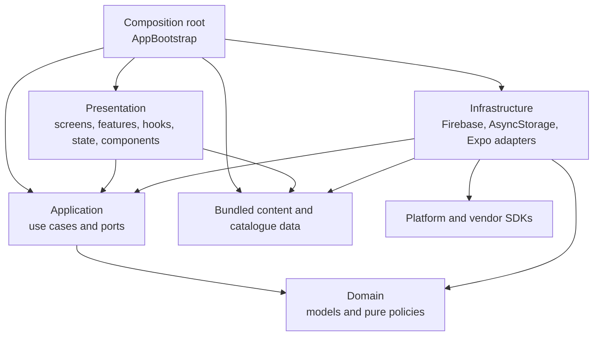

# LingoRise Clean Architecture — Güncel Referans

**Durum tarihi:** 5 Ekim 2026  
**Kapsam:** Çalışma ağacındaki `src/`, doğrulama komutları ve CI tanımı.  
**Kaynak kuralı:** Bu sayfa mimari için kanonik açıklamadır. Önceki aşamalara ait `.audit/architecture/` günlükleri tarihsel kanıttır; son doğrulama sonuçları için [güncel doğrulama kaydına](CLEAN_ARCHITECTURE_VERIFICATION.md) bakın.

## Güncel yapı

LingoRise, domain kurallarını uygulama kullanım senaryolarından ve platform adaptörlerinden ayıran katmanlı bir mimari kullanıyor. `src/app/AppBootstrap.tsx` composition root'tur; `AppNavigator.tsx` ve `getMainRoute.tsx` sunum/yönlendirme tarafındadır.



| Sorumluluk | Güncel konum | Sınır |
|---|---|---|
| Domain | `src/domain` | Modeller, öğrenme/ilerleme kuralları, migrasyonlar ve editorial politikaları. React, Firebase ve storage SDK'larına bağlı değildir. |
| Application | `src/application` | Oturum, cevap, ilerleme, senkronizasyon, hesap ve veri yönetimi kullanım senaryoları; SDK'sız portlar `ports.ts` içindedir. |
| Infrastructure | `src/infrastructure` | Firebase, AsyncStorage, katalog taşıma/cache, bildirim, konuşma, telemetry ve yedek paylaşım adaptörleri. SDK tipleri port sözleşmelerine sızmaz. |
| Presentation | `src/screens`, `src/features`, `src/state`, `src/context`, `src/components`; ayrıca navigator dosyaları | Ekran sunumu, etkileşim durumu ve application servislerinin çağrılması. Doğrudan persistence/auth adaptörü kullanmamalıdır. |
| Composition | `src/app/AppBootstrap.tsx` | Adaptörleri ve application örneğini oluşturup React ağacına verir. |
| İçerik ve ortak sunum desteği | `src/content`, `src/i18n`, `src/theme`, `src/utils`, uyumluluk amaçlı `src/types` | Veri, kopya, tema ve küçük yardımcılar. Bunlar iş kuralı veya platform erişimi için kaçış katmanı olmamalıdır. |

Bağımlılık yönü kod içindeki import yönüyle ifade edilir: application domain'e; infrastructure application portlarına ve gerekli domain modellerine; presentation application arayüzüne; composition ise uygulamayı kurmak için gereken katmanlara bağlanır. Domain dış katmanları bilmez.

`createApplication(dependencies, bundledQuestions, contentVersion)` React'ten bağımsız kurulum yüzeyidir. Composition root soru verisini ve versiyonunu enjekte eder. Bağımlılıklar factory fonksiyonlarına normal TypeScript nesneleriyle verilir; DI container eklenmemiştir. Kullanıcı modeli Firebase `User` tipini dışarı çıkarmaz. Zaman ve rastgelelik dependency olarak alınır.

## Davranış ve veri sözleşmeleri

- Application progress controller hydration ve gözlemlenebilir snapshot akışını yönetir; React hook'ları bu akışa abone olur. React state updater içinde persistence başlatılmaz.
- Cevap geçişleri yeni state ve telemetry olaylarını üretir; application yazma ve bildirim eşiklerini koordine eder.
- Remote okuma `found`, `absent` ve `failed` sonuçlarını ayırır. Başarısız okuma, remote'a ilk yazımı yetkilendirmez.
- Yerel sıfırlama ve yerel yeniden yükleme silinen veriyi buluta göndermez. Kısmi hesap silme açık hata ve güvenli tekrar denemesi davranışını korur.
- Katalog önceliği remote → cache → bundled biçimindedir; timeout, bütünlük denetimi ve bundled enrichment önceliği korunur. Değişebilir katalog durumu application örneğine aittir.
- Giriş sonrası sign-in merge, ardından mevcut progress refresh sırası `application/accountSession` use case'indedir. Auth aboneliği, timeout ve ekran/loading kararları React bootstrap'ta kalır.
- Persist edilen `UserData`, storage anahtarları, Firestore yolları, yedek zarfı ve senkronizasyon politikaları uyumluluk sözleşmeleridir.

## Otomatik sınır kontrolü ve bilinen boşluk

`npm run check:architecture`, TypeScript AST üzerinden import, re-export, import-type, literal `import()`/`require()` ilişkilerini çözüp dosya katmanları ve çevrimleri denetler. Her `src/` kökü açıkça sınıflandırılmıştır; bilinmeyen kök hata verir, genel `support` kaçışı veya geçiş allowlist'i yoktur. Application yalnızca application/domain katmanına; domain yalnızca domain'e bağlanabilir. Infrastructure'ın izinli iç hedefleri application, domain, content-data ve küçük utils katmanıdır; vendor erişimi platform adaptörleriyle sınırlandırılmıştır. Presentation infrastructure ve veri servis SDK'larına erişemez; bundled content içinden yalnızca `src/content/levels.ts` ekran seviye etiketlerini okuyabilir. Diğer katalog ve müfredat sorguları application arayüzünden sunulur.

Scanner için application regresyon testlerinde yasaklı ve izinli kenarlar, bilinmeyen kök, vendor SDK sızıntısı, literal import türleri ve döngüler doğrulanır. CI aynı AST kontrolünü ayrıca çalıştırır. Güncel çalışma ağacında kontrol başarılıdır ve istisna raporlamaz.

### Devam eden mimari iyileştirme

Sign-in merge iş akışı application'a taşındı. `AppBootstrap` hâlâ auth event aboneliği/timeout'u, katalog hazır olma durumu ve deep-link açılışını koordine eder; bunlar başlangıç/React yaşam döngüsü sorumluluklarıdır. Katalog yükleme effect'i daha sonra küçük bir presentation bootstrap hook'una alınabilir; bu, bağımlılık kuralı ihlali değildir ve düşük önceliklidir. Bundled katalog integrity ve editorial gate kodunun infrastructure tarafından content-data olarak kullanılması kasıtlı dış adaptör bağımlılığıdır.

## Kod büyüklüğü fotoğrafı

5 Ekim 2026 güncel taramasında `src/` altında 246 TypeScript/TSX dosyası bulundu. İçerik ve çeviri verileri hariç tek 250 satır üstü modül `AppNavigator.tsx` (251 satır) oldu. Satır sayısı tek başına iş mantığı God File göstergesi değildir.

AST taramasında 120 satırı aşan 13 fonksiyon/callback bulundu. En uzunları `AppNavigator` (222), `PracticeHubScreen` (200), `createProgressController` (199), `getMainRoute` (172) ve `AuthScreenBody` (171). `ProgressScreen` analitik özeti saf `progressAnalyticsModel` fonksiyonuna taşınmıştır. 120 satır bir uyarı eşiğidir; otomatik kalite hükmü değildir. Bu işlevlerde sorumluluk, karar yoğunluğu ve değişim nedenleri ayrıca incelenmelidir. Güncel ölçüm ve doğrulamalar [doğrulama kaydında](CLEAN_ARCHITECTURE_VERIFICATION.md) tutulur.

## Geliştirici doğrulama komutları

```sh
npm run typecheck
npm run check:architecture
npm run test:application
npm test
npm run test:rules
cd android && ./gradlew assembleDebug
npm run test:e2e:smoke
```

Rules ve cihaz tabanlı smoke testleri gerekli port/emulator/cihaz bulunmadan “geçti” sayılmaz. Release doğrulaması için CI'daki release derleme ve EAS imzalı üretim artefaktı ayrı değerlendirilmelidir.
